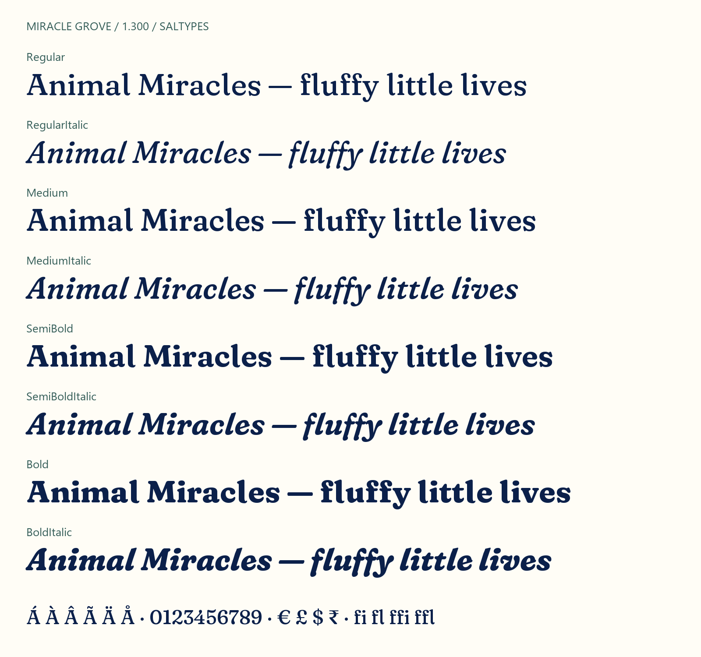

# Miracle Grove

A free soft-serif font family for headings and short editorial text. Four weights, each with a matching italic.



[Download the fonts](https://github.com/SalTypes/miracle-grove/releases/latest) · [Try the specimen](https://saltypes.github.io/miracle-grove/) · [Read the usage guide](documentation/usage.md)

## Start using it

Extract the latest release ZIP. Install the eight `.ttf` files in `ttf`, then restart your design app.

For websites, copy the `web` folder to your project and load its stylesheet.

```html
<link rel="stylesheet" href="fonts/web/miracle-grove.css">
```

```css
h1 {
  font-family: "Miracle Grove", Georgia, serif;
  font-weight: 600;
  font-synthesis: none;
}

.donation-total {
  font-variant-numeric: tabular-nums;
}
```

Use weights **400**, **500**, **600**, or **700**. Set `font-style: italic` for the matching italic.

## What you get

| Detail | Release 1.300 |
|---|---|
| Styles | Regular, Medium, SemiBold, Bold, with matching italics |
| Formats | Static TrueType and WOFF2 |
| Character coverage | 639 encoded characters per style |
| Glyphs | 710 per style, including alternate forms |
| Scripts | Latin; English and Spanish samples tested |
| Features | Kerning, standard ligatures, tabular figures, expressive alternates |
| License | SIL Open Font License 1.1 |

## Where it came from

Miracle Grove began as a companion to lettering explored for Animal Miracles. The brief called for a warm identity that could represent all animals.

The font adapts [Fraunces by Undercase Type](https://github.com/undercasetype/Fraunces), designed by Phaedra Charles and Flavia Zimbardi. Most of the underlying letterforms remain theirs.

This edition selects a fixed optical size and softness. The returning upright **l** now accompanies an arched **A** bridge and refinements to selected shoulders, legs, and terminals.

Version **1.200** gives the italic **l** an angled cap and reduces the bulbs of **f**. Related accents and ligatures follow those changes.

Version **1.300** shortens the upright **l** foot and improves its spacing with rounded neighbors, including related accents and ligatures.

Tabular figures and ligature caret positions extend its typesetting features. [The design notes](documentation/design.md) explain what this edition inherits from Fraunces.

Salman Ravoof maintains this derivative through SalTypes. Development and testing were assisted by OpenAI Codex. This project is independent of Undercase Type.

## Know its limits

Miracle Grove works best at display sizes. Proof your layout before using it for long reading or fine print.

It does not cover Arabic, Indic, or CJK scripts. It has no variable font, small caps, or arbitrary-fraction feature.

The release passed FontBakery's Universal profile without failures or errors. Remaining warnings and application tests are listed in [the quality report](documentation/quality.md).

You can compare difficult words in [the spacing proof](https://saltypes.github.io/miracle-grove/spacing-proof.html). [The spacing report](documentation/spacing.md) explains the tests and their limits.

## Build and contribute

You can build from the included, hash-verified upstream inputs. Once you install the dependencies, building requires no network connection.

```sh
python -m pip install -r requirements.txt
python scripts/build.py
python scripts/test_fonts.py
```

Read [the build guide](documentation/building.md) before changing the sources. Report rendering problems with the exact text, font style, application, and a screenshot.

## Use it freely

You can use Miracle Grove in personal and commercial work. You can also modify and redistribute the font under the included [SIL Open Font License](OFL.txt).

Keep the copyright notice and license with redistributed font files. The font software cannot be sold by itself. Your artwork does not inherit the font's license.
